# package-content-elementizer

Reads a PDF or Word (DOCX) document and turns it into structured JSON **elements**: headings, paragraphs and tables, in reading order, with their page numbers and a heading outline. Downstream services index those elements instead of raw text, so a document's structure survives.


| Start here | Go deeper |
| :--- | :--- |
| [What it is](#what-it-is) | [Architecture: how PDF and DOCX are read](docs/architecture.md) |
| [Where this fits](#where-this-fits) | [Usage and examples](docs/usage-and-examples.md) |
| [Quickstart](#quickstart) | [Troubleshooting](docs/troubleshooting.md) |
| [What this repo is not](#what-this-repo-is-not) | [Configuration](docs/architecture.md#configuration) |

All pages: [docs/](docs/README.md).

## What it is

An **element** is one structural block of a document: a paragraph (with its style, such as Heading 1), a table (with rows, cells and header cells), or a header or footer. The output follows the `DocumentModel` shape from [base-tdb-models](https://github.com/TalkingDB/base-tdb-models), plus a **file index**: the document's outline built from its headings.

- **DOCX** is read directly with [python-docx](https://python-docx.readthedocs.io/). Page numbers are worked out by rendering the file with LibreOffice.
- **PDF** is first converted to DOCX with [pdf2docx](https://pdf2docx.readthedocs.io/) (in a separate process that can be stopped), then read the same way.

## Where this fits

<picture>
  <source media="(prefers-color-scheme: dark)" srcset="docs/images/where-package-content-elementizer-fits-dark.svg">
  
</picture>

<sub>Diagram source: [where-package-content-elementizer-fits.mmd](docs/diagrams/where-package-content-elementizer-fits.mmd). Edit it and re-render with the steps in [docs/diagrams](docs/diagrams/README.md).</sub>

In words: TTT hands each uploaded file to this service and gets back its elements and outline, which it then indexes; the elementizer itself keeps nothing except, optionally, a copy of a DOCX with page breaks added.

## Quickstart

You need Python 3.12 or 3.13, [Poetry](https://python-poetry.org/docs/#installation), the three `base-tdb-*` repositories checked out next to this one, and LibreOffice Writer (`soffice` on your `PATH`) for DOCX page numbers.

```bash
make sync MODE=git      # or MODE=local for editable base-tdb-* checkouts
poetry install
make local              # API on http://localhost:8091, Swagger at /docs
```

Then parse a file:

```bash
curl -s -X POST http://localhost:8091/content/parse -F "document_file=@sample.docx"
```

> [!WARNING]
> With the default `CE_DOCX_PAGINATE=1`, importing the reader fails with `EnvironmentError` if `soffice` is not on the `PATH`. Install `libreoffice-writer`, or set `CE_DOCX_PAGINATE=0` to skip DOCX page numbers.

Or run it in [Docker](https://docs.docker.com/get-started/docker-overview/), where LibreOffice is installed for you:

```bash
docker build -t talkingdb-ce .
docker run -p 8091:8091 talkingdb-ce
```

## What this repo is not

- **Not [OCR](https://en.wikipedia.org/wiki/Optical_character_recognition).** A scanned PDF with no text layer fails with a clear message; images of text are not read.
- **Not a search index.** It returns elements; indexing and querying them is [module-ttt](https://github.com/TalkingDB/module-ttt).
- **Not for other formats.** Only `.pdf` and `.docx` are accepted. Convert other files first.
- **Not able to open protected PDFs.** Password protected files are rejected.

## Related repositories

| Repository | Relationship |
| :--- | :--- |
| [module-ttt](https://github.com/TalkingDB/module-ttt) | The main consumer; pins this package and turns elements into a graph |
| [base-tdb-models](https://github.com/TalkingDB/base-tdb-models) | Defines `DocumentModel`, `ParagraphModel`, `TableModel` and `FileIndexModel` |
| [base-tdb-helpers](https://github.com/TalkingDB/base-tdb-helpers) | Events, metadata, request context and [MinIO](https://en.wikipedia.org/wiki/MinIO) file storage |
| [talkingdb-benchmarks](https://github.com/TalkingDB/talkingdb-benchmarks) | Public tests of what document reading gets right and wrong |

## Further reading

- [python-docx documentation](https://python-docx.readthedocs.io/)
- [pdf2docx documentation](https://pdf2docx.readthedocs.io/)
- [PyMuPDF documentation](https://pymupdf.readthedocs.io/)
- [LibreOffice headless conversion](https://help.libreoffice.org/latest/en-US/text/shared/guide/start_parameters.html)

## Code contributor

mayank.g@smarter.codes

## License

Licensed under the GNU Affero General Public License v3.0 ([AGPL-3.0](https://www.gnu.org/licenses/agpl-3.0.html)). See [LICENSE](LICENSE).
