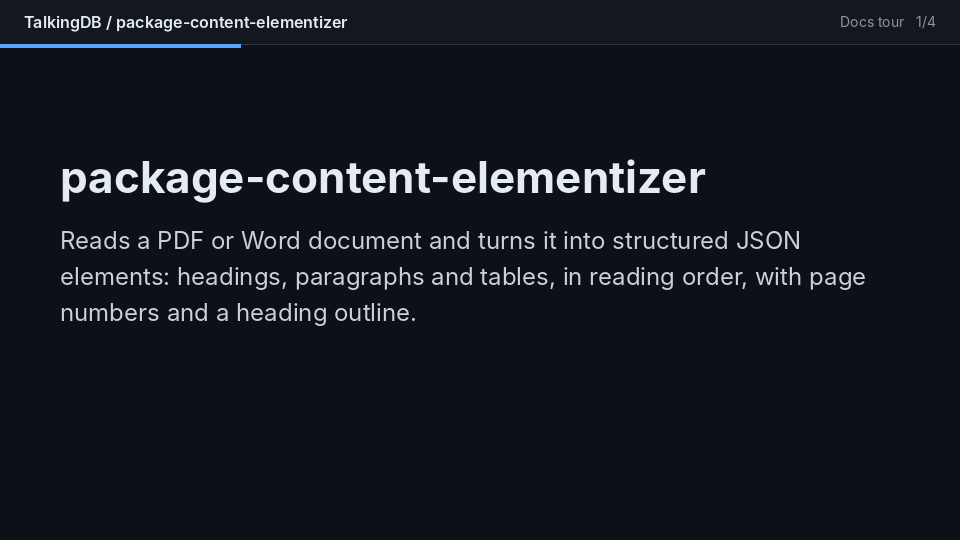

<!-- short-readme -->
<h1 align="center">package-content-elementizer</h1>

<p align="center"><b>Read a PDF or Word file into headings, paragraphs and tables, in reading order.</b></p>

<p align="center"><a href="#try-it">Try it</a> · <a href="docs/architecture.md">How it works</a> · <a href="docs/usage-and-examples.md">Usage and examples</a> · <a href="docs/troubleshooting.md">Troubleshooting</a> · <a href="docs/reference.md">Full reference</a></p>

<p align="center"><a href="https://github.com/TalkingDB/package-content-elementizer/stargazers"></a> <a href="https://www.gnu.org/licenses/agpl-3.0.html"></a></p>

<p align="center">
  
</p>
<p align="center"><sub>A real run of <code>DocxReader</code> at <code>ef8bf51</code> on a sample returns policy, 27 Nov 2026: seven elements in about 26 ms.</sub></p>

Downstream services index these **elements** instead of raw text, so a document keeps its structure: each element has an id, its parent heading and its page.

## What it does

- **Reads** PDF and DOCX ([how it reads a file](docs/architecture.md)).
- **Keeps structure**: headings nest, bold runs and table cells survive.
- **Returns JSON** with an outline, ready to index ([examples](docs/usage-and-examples.md)).

## Try it

```bash
make sync MODE=git
poetry install
make local             # API on http://localhost:8091, Swagger at /docs
curl -s -X POST http://localhost:8091/content/parse -F "document_file=@sample.docx"
```

DOCX page numbers need LibreOffice (`soffice` on your PATH); see [troubleshooting](docs/troubleshooting.md).

## Where it fits

[module-ttt](https://github.com/TalkingDB/module-ttt) hands every upload to this service and indexes what comes back.

## Learn more

| Page | Read it to |
| :--- | :--- |
| [How it works](docs/architecture.md) | see the parts and how data moves |
| [Usage and examples](docs/usage-and-examples.md) | copy working examples |
| [Troubleshooting](docs/troubleshooting.md) | fix a problem |
| [Full reference](docs/reference.md) | read everything that used to be on this page |
| [All docs](docs/README.md) | see every page |

## Support TalkingDB

If package-content-elementizer saved you time, please [give it a star](https://github.com/TalkingDB/package-content-elementizer) ⭐. Stars help other developers find the project.

Found a bug, or a document it gets wrong? [Open an issue](https://github.com/TalkingDB/package-content-elementizer/issues/new). We are always here to help and open to a conversation. Explore the TalkingDB applications at [talkingdb.io](https://talkingdb.io/#applications).

## License

Licensed under the GNU Affero General Public License v3.0 ([AGPL-3.0](https://www.gnu.org/licenses/agpl-3.0.html)). See [LICENSE](LICENSE).
