# Architecture

[Docs home](README.md) › Architecture

How a file becomes elements, which settings change that, and where each step lives in the code. For setup, start at the [README](../README.md).

## From file to elements

<picture>
  <source media="(prefers-color-scheme: dark)" srcset="images/how-the-content-elementizer-reads-a-file-dark.svg">
  
</picture>

<sub>Diagram source: [how-the-content-elementizer-reads-a-file.mmd](diagrams/how-the-content-elementizer-reads-a-file.mmd). Edit it and re-render with the steps in [docs/diagrams](diagrams/README.md).</sub>

In words: PDFs are checked, converted to DOCX in a separate process and rejected if they have no real text; DOCX files optionally get page numbers from a LibreOffice render; both are read into one document model, and an outline is built from its headings.

## File responsibility map

| File | Does |
| :--- | :--- |
| [`api/reader.py`](../talkingdb_ce/api/reader.py) | `POST /content/parse`; wraps the read in events, request context and call logging; returns `document` and `file_index` |
| [`services/reader/reader.py`](../talkingdb_ce/services/reader/reader.py) | Picks the reader by extension (`docx` or `pdf`); raises `UNSUPPORTED_FILE_TYPE` otherwise |
| [`services/reader/pdf/pdf_reader.py`](../talkingdb_ce/services/reader/pdf/pdf_reader.py) | Password check with PyMuPDF, conversion to DOCX, empty text check, page numbers |
| [`services/reader/pdf/_convert_main.py`](../talkingdb_ce/services/reader/pdf/_convert_main.py) | The conversion process, run in batches of pages |
| [`services/reader/killable_subprocess.py`](../talkingdb_ce/services/reader/killable_subprocess.py) | Runs conversions in a child process that can be cancelled or timed out |
| [`services/reader/docx/docx_reader.py`](../talkingdb_ce/services/reader/docx/docx_reader.py) | Reads paragraphs, styles, tables, headers and footers into the model |
| [`services/reader/docx/docx_paginate.py`](../talkingdb_ce/services/reader/docx/docx_paginate.py) | Renders DOCX with `soffice`, matches page texts back to paragraphs, and can store a copy with explicit page breaks in [MinIO](https://en.wikipedia.org/wiki/MinIO) |
| [`client/client.py`](../talkingdb_ce/client/client.py) | `CEClient`: direct (in process) or API mode |

## What comes back

```text
{
  "document":   DocumentModel as JSON  (layouts, paragraphs, tables, page numbers, element ids)
  "file_index": FileIndexModel          (the heading outline)
}
```

Both shapes are defined in [base-tdb-models](https://github.com/TalkingDB/base-tdb-models/blob/main/docs/architecture.md#file-responsibility-map). Element IDs are assigned by the model and are what [module-ttt](https://github.com/TalkingDB/module-ttt) links its graph nodes to.

## Configuration

| Variable | Default | Effect |
| :--- | :--- | :--- |
| `CE_DOCX_PAGINATE` | `1` | Render DOCX with LibreOffice to get page numbers. Set `0` when `soffice` is not installed |
| `CE_DOCX_PAGINATE_TIMEOUT_SECONDS` | `1800` | Time limit for that render |
| `CE_PDF_CONVERT_TIMEOUT_SECONDS` | `3600` | Time limit for PDF to DOCX conversion |
| `CE_PDF_CONVERT_MAX_MEMORY_MB` | `0` (no limit) | Memory cap for the conversion process |
| `CE_PDF_CONVERT_BATCH_PAGES` | `50` | Pages converted per batch |
| `CE_PDF_MIN_TEXT_CHARS` | `16` | Below this, a PDF is treated as having no text layer |
| `CLIENT_MODE`, `CE_HOST` | `direct`, none | How `CEClient` calls this package (see [base-tdb-helpers](https://github.com/TalkingDB/base-tdb-helpers/blob/main/docs/architecture.md#two-ways-to-call-a-sibling-service)) |
| MinIO settings | see [base-tdb-clients](https://github.com/TalkingDB/base-tdb-clients#configuration) | Only used to store a DOCX copy with page breaks |

The `metadata` form field may carry a release `channel`. Only `localhost` or `ttt-rc<N>` are accepted; anything else is ignored.

## Dependencies

As of 25 November 2026 this repository pins `base-tdb-models` at `3295d40`, `base-tdb-clients` at `29abea2` and `base-tdb-helpers` at `1fef6ea`. It is pinned by [module-ttt](https://github.com/TalkingDB/module-ttt) at `4432000`; the head of this repository's `main` is `9f94573`.

---

**Related:** [Troubleshooting](troubleshooting.md) · [Usage and examples](usage-and-examples.md) · [README](../README.md)
